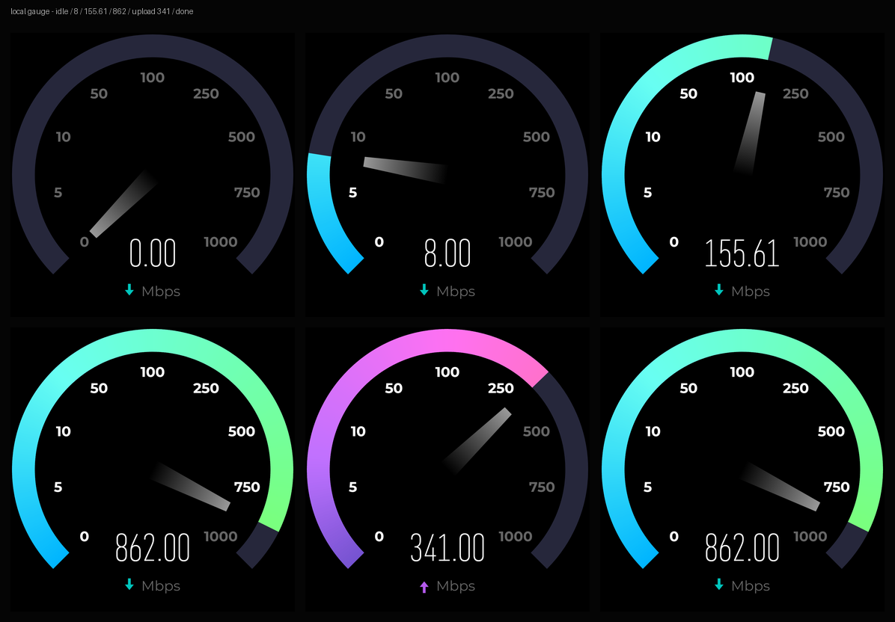
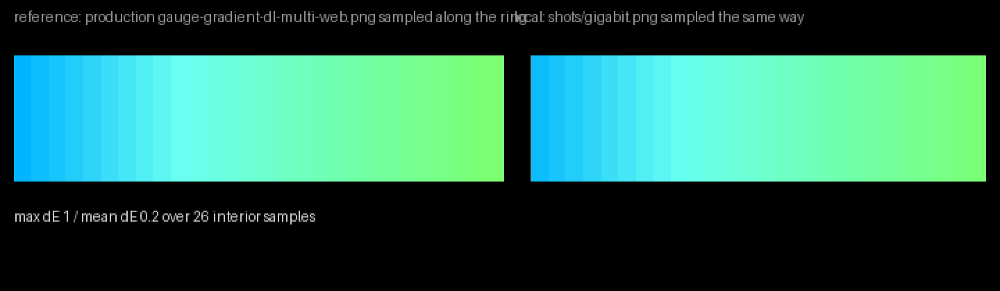
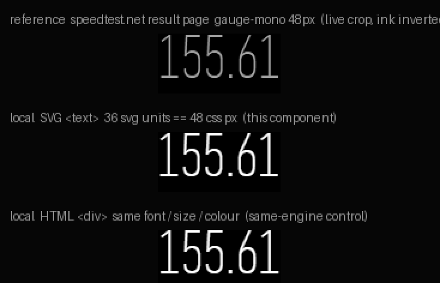

# Speedtest gauge — SVG replica

[](https://github.com/HELPMEEADICE/speedtest-gauge-svg/actions/workflows/ci.yml)
[](LICENSE)

高保真复刻 [speedtest.net](https://www.speedtest.net/) 经典动态测速仪表盘的独立组件。
TypeScript + SVG，无框架、无重量级依赖，`dist/` 产物 21 kB（gzip 7.5 kB）。



---

## 1. 运行方法

```bash
npm install
npm run dev          # http://localhost:5178/
npm run build        # 类型检查 + 生产构建到 dist/
npm run preview      # 预览构建产物 http://localhost:5179/
```

页面打开即为交互式演示：

| 控件 | 作用 |
|---|---|
| **Run demo** | 播放完整模拟测速流程（延迟 → 下载 → 归零 → 上传 → 完成） |
| **Reset** | 指针 500 ms 归位到起始角 |
| 滑块 | 直接把 0–10000 Mbps 推给仪表 |
| **Single** | 切换 multi / single 连接模式（换渐变与强调色） |
| **Extend scale > 1 Gbps** | 打开扩展刻度阶梯 |
| **Idle / Download / Upload / Done** | 冻结到指定阶段，便于截图与校准 |

截图/校准专用查询参数（`?` 后组合）：

```
?bare=1                      隐藏控制面板
?static=862&stage=download   冻结到 862 Mbps 的下载态
?autoplay=1&seed=7           自动播放演示（固定随机种子，可复现）
?theme=light                 浅色主题
?mode=single&scale=auto      单连接模式 + 扩展刻度
```

---

## 2. 第一阶段：对原站的研究方法与结论

### 2.1 研究手段

| 手段 | 产出 |
|---|---|
| Playwright + Chromium 访问 `https://www.speedtest.net/`，导出实时 DOM / 计算样式 | `research/live-dom.json`、`report/reference-live-go-state.png` |
| 下载并静态分析站点公开加载的构建产物（`index-COwyiHic.js` 4.3 MB、`index-DbXEWsKD.css`） | `research/app.js`、`research/app.css`、`research/gauge.svg` |
| 公开结果页取样（`/result/19869366452`，仅加载页面，不发起测速） | `report/reference-live-result-page.png` |
| 下载并逐像素采样站点自带的 4 张仪表渐变贴图 | `research/gradient-samples.json`、`report/reference-gradient-assets.png` |
| 切换站点主题后读取计算样式 | `report/reference-live-dark.png`、`research/dark-theme.json` |

### 2.2 渲染技术判定（结论：**SVG**，不是 Canvas，也不是 CSS 圆环）

原站仪表是一个 `<svg>`：一条 `stroke-width` 描边的 270° 圆弧 + 一个被扇形 `clipPath` 裁切的渐变位图 + 一个绕中心 `rotate()` 的指针多边形 + `<text>` 刻度。关键证据（构建产物原文）：

```js
jsxRuntimeExports.jsx("g",{transform:`rotate(${De}, ${centerX}, ${centerY})`,
  children: jsxRuntimeExports.jsx("path",{d:needlePath, fill:ce?`url(#${ie})`:`url(#${se})`})})
```

因此本实现也选 SVG（而非 Canvas 2D）——这也是「像素级同构」的前提。

### 2.3 已核实的常量（全部来自构建产物，逐条可溯源）

```js
const GAUGE_RADIUS = 130, GAUGE_LABEL_VALUES = [0,5,10,50,100,250,500,750,1e3],
      RADIUS = GAUGE_RADIUS, STROKE_WIDTH = 23,
      NEEDLE_BASE_WIDTH = 20, NEEDLE_TIP_WIDTH = 10, NEEDLE_LENGTH = 85,
      C = 2*Math.PI*RADIUS, DISC_R = 45, DISC_SW = 90;

function calculateGaugeValues(e){ const N = e*2.2, $ = 135;
  return {containerSize:N, centerX:N/2, centerY:N/2, endAngle:$, startAngle:-1*$} }
// -> containerSize 286, center 143,143, startAngle -135, endAngle +135（0° 朝上，顺时针）

const TIMING = { needleTracking:0.2, needleReturn:0.5, labelStagger:.08, labelFadeIn:.08 };
```

刻度半径 `RADIUS - 33 = 97`；刻度 `fontSize 14 / fontWeight bold / textAnchor middle / dominantBaseline middle`；
数字 `font-mono text-4xl font-medium` → **Gauge Mono 36 px / 500**；单位行 `mt-1 text-sm` → 14 px；
数字块 `absolute right-0 bottom-4 left-0 text-center` → 底边距 16 单位。

### 2.4 非均匀刻度映射（本项目最核心的一条）

原站**不是**线性刻度，也**不是**对数刻度。刻度值等角分布，指针在所在档位内做线性插值：

```js
determineLabelAngle = (labels, v) =>
  labels.findIndex(x => x >= v) / (labels.length - 1) * (endAngle - startAngle) + startAngle;

determineNeedleAngle = (labels, v) => {
  const i = labels.findIndex(x => x >= v);
  if (i === -1) return determineLabelAngle(labels, labels.at(-1));   // 超出上限 → 夹在末端
  if (v === labels[i]) return determineLabelAngle(labels, labels[i]);
  const prev = i === 0 ? 0 : i - 1;
  const t = (v - labels[prev]) / (labels[i] - labels[prev]);
  return angle(prev) + t * (angle(i) - angle(prev));
};
```

9 个刻度 → 每档恒定 `270/8 = 33.75°`：

| 值 | 0 | 5 | 10 | 50 | 100 | 250 | 500 | 750 | 1000 |
|---|---|---|---|---|---|---|---|---|---|
| 角度 | −135° | −101.25° | −67.5° | −33.75° | 0° | 33.75° | 67.5° | 101.25° | 135° |

于是 `0→100 Mbps` 与 `250→1000 Mbps` 各占相同的 135°。`src/gauge/scale.ts` 完整实现该算法，并有反函数 `valueForAngle`。

### 2.5 颜色（暗色主题，全部实测）

| token | 值 | 来源 |
|---|---|---|
| 页面底色 | `color(display-p3 0 0 0)` = 纯黑 | 实时切换主题后的 `getComputedStyle(body).backgroundColor` |
| 未激活圆环 | `#26273b`（`ooklaLightNavy`） | 暗色 `custom.gaugeArcInactiveTrack` |
| 刻度点亮 / 熄灭 | p3(1,1,1) / p3(0.399)≈`#666666` | `highEmphasisText` / `inverseSecondaryText` |
| 数字 | p3(1,1,1) | `highEmphasisText` |
| 下载强调色 | `accentTeal` = p3(0, 0.773, 0.749) | 结果页实测同色 |
| 上传强调色 | `accentPurple` = p3(0.671, 0.38, 0.91) | 结果页实测同色 |
| 指针 | 顶端 60% 白 → 底端全透明，objectBoundingBox 纵向 | 暗色 `linearGradient` 定义 |

圆环渐变不是 CSS 渐变：原站用一张 720×720 位图按扇形裁切。本项目**不复制该贴图**，而是沿弧长采样其真实像素后重建为角向矢量渐变（`GRADIENT_STOPS`，28 个采样点）。采样证明颜色沿半径**恒定**（r=100…150 同角同色），所以角向重建是精确等价的。

| 变体 | 起点（0 Mbps） | 终点（1000 Mbps） |
|---|---|---|
| download multi | `#00b5fe` | `#7bfe71` |
| upload multi | `#7553d0` | `#fe70a8` |
| download single | `#ff6b7b` | `#ffba6b` |
| upload single | `#70ff9f` | `#cfff70` |

### 2.6 明确无法观察的部分（未编造）

- **测速过程中的仪表截图未能取得。** 按你的要求没有真正发起测速，而该仪表只在测试进行中出现（测速前站点显示的是 GO 圆环，结果页不渲染仪表）。因此数值/相位/指针外观均来自**构建产物代码 + 贴图像素采样 + 结果页实测字体**，不是对着一张动图猜的。
- 指针在暗色下的观感（亮端在外、向轴心溶解）完全按代码复刻，但未与真实运行截图做视觉回归。
- `.5s` 阶段切换时原站还会播放一次"白色文字闪一下"（`labelFlashVariants`，opacity 1→0，80 ms）以及 GO 圆环与仪表之间的 morph 过渡；这两处未复刻（见第 6 节）。

### 2.7 参考物料

| 文件 | 说明 |
|---|---|
| `report/reference-live-go-state.png` | 实时站点测速前状态（含 GO 圆环、真实排版） |
| `report/reference-live-dark.png` | 切换暗色主题后的实时页面（纯黑底） |
| `report/reference-live-result-page.png` | 公开结果页：真实 Gauge Mono 数字与下载/上传强调色 |
| `report/reference-gradient-assets.png` | 站点自带的 4 张仪表渐变贴图（dl/ul × multi/single） |
| `research/gauge.svg`、`research/live-dom.json` | 实时 DOM 快照 |

---

## 3. 实现结构

```
src/
  gauge/
    tokens.ts         几何/配色/时序常量（每条带出处注释）
    scale.ts          刻度表 + 值↔角度映射 + 数字格式化
    geometry.ts       polar / arcPath / sectorPath
    animator.ts       共享 RAF 时钟、三次贝塞尔、阻尼弹簧、指针微颤
    gauge.ts          仪表视图：构建 SVG、逐帧只改 3 个属性
    pipeline.ts       数据层：DemoSource / ManualSource / WebSocketSource
    gradient-stops.ts 由 tools/emit_stops.py 从真实贴图采样生成
  main.ts             装配、控件、URL 参数、window.speedGauge
  styles.css          页面外壳（字体、面板）
tools/                研究、截图、审计、像素比对脚本
```

绘制与数据完全解耦：视图层只接受 `setSpeed(kbps)` 与 `setStage(stage)`。

### 3.1 单位约定

与原站一致：内部量纲是 **kbps**，显示与刻度是 **Mbps**。
`speedLocalized` 的行为被完整保留——**恒定两位小数**、`en-US` 千分位（`862.00`、`4,200.00`），0 显示 `0.00`。

### 3.2 动画

单个 `requestAnimationFrame` 时钟，每帧最多写 3 个属性（扇形 `clip-path` 的 `d`、指针 `transform`、数字文本），无布局抖动、无组件重渲染。

两种跟踪模型（`animator.ts`）：

- **`spring`（默认）**：阻尼弹簧，`ω = 21.4 rad/s` 使其阶跃响应 ≈ 200 ms 收敛，与原站 `needleTracking: 0.2` 的体感一致，但速度连续（无重定向瞬间的加速度突变）；`ζ = 0.92` 留出真实仪表的极轻微过冲。
- **`tween`**：逐字复刻原站——每次收到样本就从当前角出发重开一段 200 ms `cubic-bezier(0,0,0.58,1)`，阶段切换走 500 ms `cubic-bezier(0.42,0,0.58,1)` 归位。

叠加一层**速度驱动的微颤**：振幅 `min(1.1°, |ω| × 0.0032)`，6.5 Hz，用 90 ms 时间常数跟随——只在速度剧变时出现，稳态几乎不可见。可用 `new Gauge(el, { motion: { wobbleMax: 0 } })` 关掉。

数字与圆弧高亮都由指针角度驱动：扇形 `clip-path` 与指针共用同一个角度，刻度点亮判定用 `value===0 ? angle > labelAngle : angle >= labelAngle`（与原站一致），因此三者永远同帧同步。

### 3.3 刻度切换（0–10000 Mbps）

原站观察结果：**没有刻度切换**，超过 1000 Mbps 时指针夹在末端角 135°，数字仍显示真实值。

因此默认 `scaleMode: 'fixed'` 就是这一行为（完全保真）。
另提供 `scaleMode: 'auto'`：当样本 > 1000 Mbps 时切到 10 档阶梯 `[0,10,50,100,250,500,1000,2500,5000,10000]`（每档 30°，保持与原 9 档相当的标签间距）。这是本项目的**扩展**，不是原站行为，默认关闭。

### 3.4 真实数据接入

```ts
// 1) 直接推样本（kbps）
window.speedGauge.setStage('download');
window.speedGauge.setSpeed(152_300);      // 152.30 Mbps

// 2) 或用数据源抽象
import { ManualSource, WebSocketSource } from './gauge/pipeline';
const src = new WebSocketSource('ws://localhost:9000/speed');  // {kbps, stage}
src.start(({ kbps, stage }) => { gauge.setStage(stage); gauge.setSpeed(kbps); });

// 3) 或 import 组件
import { Gauge } from './gauge/gauge';
const g = new Gauge(container, { theme: 'dark', connectionMode: 'multi', scaleMode: 'fixed' });
```

`window.speedGauge` 完整方法：`setSpeed / setStage / snapTo / reset / setConnectionMode / setScaleMode / playDemo / stop / manual / gauge`。

---

## 4. 像素级校准结果（可复现）

工具：`tools/audit.mjs`（DOM 几何审计）、`tools/compare.py`（环色/径向/指针角）、`tools/font-probe.mjs`（数字度量）、`tools/number-diff.mjs`（同尺度数字比对）、`tools/shoot.mjs`（状态截图）。

### 4.1 圆弧颜色 vs 真实贴图

沿弧中半径按同样 28 个角度采样本地渲染的 1000 Mbps 状态（`tools/shoot.mjs` 产出的 `shots/gigabit.png`），与 `gauge-gradient-dl-multi-web.png` 逐点比较：

```
interior samples=26   max ΔE = 1.4   mean ΔE = 0.2      (RGB 欧氏距离, 量程 0–441)
```

逐点几乎完全一致（多数点 ΔE = 0.0）。



### 4.2 圆弧几何

17°（无刻度文字）处径向扫描：

```
实测 r = 118.62 … 141.70，环宽 23.07      规范 118.5 … 141.5，环宽 23.0
误差  内 +0.12 / 外 +0.20 / 宽 +0.07   （单位 = viewBox 用户单位，1 单位 ≈ 1 px @286）
```

### 4.3 数字字体

`canvas.measureText` 在同口径下比对原站 `gauge-mono` 与本组件 `Gauge Mono`：

```
"155.61" @48px   参考 102.140625 px   本地 102.140625 px   Δ = 0.000 %
单字宽           18.70 px (×10 位完全相同)   点号 8.63 px   每字符 35.465 %em
墨迹宽高比        参考 2.685   本地 2.673               Δ = 0.45 %
同尺度墨迹框      SVG 99×36    HTML 99×36（同引擎对照，完全一致）
```



该图第三行是**同引擎对照**：把同一字体、同一 48 px、同一白色放在 HTML `<div>` 里渲染，与本组件的 SVG `<text>` 逐像素完全同尺寸。因此第一/二行之间的笔画粗细差异来自「暗字亮底 vs 亮字暗底」的 sRGB 抗锯齿合成，而非字体或排版差异。

### 4.4 排版锚点（`tools/audit.mjs`）

| 元素 | 规范值 | 实测（用户单位） | 误差 |
|---|---|---|---|
| 数字中心 | (143, 226) | (143.00, 226.00) | 0 |
| 单位行中心 | (143, 260) | (143.00, 260.00) | 0 |
| 刻度 `100` | (143, 46) | (142.75, 44.62) | 文字墨迹中心 vs 锚点 |
| 刻度 `0` / `1000` | (74.4, 211.6) / (211.6, 211.6) | (74.65, 210.21) / (211.33, 210.21) | 同上 |
| 指针角度 @862 Mbps | 116.37° | 116.370° | 0 |
| 轨道弧 `d` | `M 51.076 234.924 A 130 130 0 1 1 234.924 234.924` | 同 | 0 |

### 4.5 响应式与高 DPI

把舞台设为 300 / 440 / 640 px，所有锚点归一化到 286 框后**完全一致**：

```
300px  number(0.5, 0.7902, w0.2679)  unit(0.5, 0.9091)  label100(0.4991, 0.1560)  arcSpan 260.0
440px  同上（逐位相同）
640px  同上（逐位相同）
```

DPR 1 / 2 / 3 下数字锚点恒为 `(143, 226)`。

### 4.6 动画连续性

`tools/shoot.mjs` 以 62 ms 间隔采样 90 帧指针角度：空闲 −135° → 峰值 118.2°，相位切换处 500 ms 归位，稳态抖动 ≈ 0.17°（微颤），无跳变帧、无越界。

---

## 5. 无法完全一致 / 已知差异

1. **测速中状态缺少真实截图对照**（第 2.6 节）。几何与颜色有代码和贴图双重佐证，但"看起来是否一模一样"这一层只能在能真实跑测速的环境里做最后一步回归。
2. **圆环用矢量角向渐变，原站用位图裁切。** 颜色在弧上逐点等价（ΔE ≤ 1.4），但原贴图边缘自带 1 px 抗锯齿；本项目在极细观察下扇区边界更锐利。段数可调（`ringSegments`，默认 240）。
3. **数字用 SVG `<text>`，原站用 HTML 文本。** 度量与墨迹框完全一致（4.3 节），但 HTML 的 `line-height` 盒模型与 SVG 基线锚定不同，本实现按 CSS 盒模型反算成 `y=226 / 260` 两个锚点。
4. **未复刻的动效**：刻度点亮时的白色闪烁（80 ms）、GO 圆环 ↔ 仪表的 morph（`DISC_R 45 / DISC_SW 90` 那组动画）、连接中显示 "Connecting…" 文案。三者都属于阶段过渡装饰，不影响稳态与测速过程。
5. **微颤是本项目新增的**。原站只有纯 tween，无抖动。振幅上限 1.1° 且由指针角速度驱动，稳态不可见；需要严格保真时置 `wobbleMax: 0`。
6. **`scaleMode: 'auto'` 是扩展**，原站无刻度切换（2.3、3.3 节）。
7. **仪表字体随仓库分发**：`public/fonts/gaugemono.woff2` 取自 speedtest.net 公开 CDN，已一并提交，克隆后开箱即得与原生一致的像素效果（无需额外步骤）。站点自带的渐变贴图与构建产物仍不进仓库，`npm run fetch-assets` 可在本地拉回以复现 `tools/sample_gradient.py` 的采样流程。`montserrat.woff2` 为 SIL OFL 1.1，随附 `public/fonts/OFL.txt`。

---

## 6. 复现校准的命令

```bash
npm run dev                                  # 另开一个终端
node tools/shoot.mjs                         # 8 个状态截图 -> shots/（构建产物，已忽略）
node tools/audit.mjs                         # DOM 几何审计
node tools/demo-check.mjs                    # 演示流程 / 阶段机 / 同步性
python tools/compare.py                      # 环色/几何/指针角 -> report/compare-ring.png
node tools/font-probe.mjs                    # 数字度量 vs 原站（canvas measureText）
node tools/number-diff.mjs                   # 同尺度数字裁剪（DPR 1，双方均 48 px）
node tools/number-polarity.mjs               # SVG vs HTML 同引擎对照
node tools/artifacts.mjs                     # 状态图 + 参考裁剪 -> report/
python tools/compose.py                      # 拼版对比图
```

（`research/` 下是第一阶段抓取的原始证据：实时 DOM、构建产物、渐变贴图、真实截图。）

---

## 7. 许可

本项目原创代码以 **WTFPL v2**（Do What The Fuck You Want To Public License, Version 2, December 2004）发布，全文见 `LICENSE`：

```
0. You just DO WHAT THE FUCK YOU WANT TO.
```

即：随便用、随便改、随便商用、随便再许可，不要求署名、不提供任何担保。

**第三方资产**：`public/fonts/gaugemono.woff2` 取自 speedtest.net 公开 CDN，已随仓库一并分发；仪表渐变贴图与站点构建产物不进仓库，`npm run fetch-assets` 可在本地拉取以便复现采样流程。本项目 WTFPL 覆盖的是原创代码，对这些第三方资产不构成授权声明。`public/fonts/montserrat.woff2` 依 SIL OFL 1.1 分发，全文见 `public/fonts/OFL.txt`。

```
speedtest gauge — SVG replica
Copyright (C) 2026 HELPMEEADICE
Licensed under the Do What The Fuck You Want To Public License, Version 2.
```

---

## 8. 代码检查与 CI

GitHub Actions 工作流：`.github/workflows/ci.yml`，触发于 push 到 main、所有 PR 和手动派发。

| job | 内容 | 命令 |
|---|---|---|
| `syntax · types · lint` | TypeScript 类型检查（tsc 同时即语法检查）、ESLint、Python 工具脚本语法 | `npm run typecheck` / `npm run lint` / `python3 -m py_compile tools/*.py` |
| `build` | 生产构建 + 产物体积写入 Job Summary + 上传 `dist` artifact | `npm run build` |
| `headless smoke` | 依赖 `build`，下载 artifact 后用 Chromium 断言真实渲染结果 | `node tools/ci-smoke.mjs <url>` |

ESLint 用 flat config（`eslint.config.js`），按两类代码分级：

- `src/**/*.ts`：`typescript-eslint` 的 **type-aware** 规则集（`recommendedTypeChecked` + `projectService`），外加 `eqeqeq / no-var / prefer-const / consistent-type-imports`；
- `tools/**/*.mjs`：普通 `recommended`，同时开启 node + browser 全局（这些脚本会把回调传进 `page.evaluate()`）。

`headless smoke` 不是"页面能打开"式的摆设，它对着**生产构建产物**断言 32 项：

- 硬锚点：0 Mbps → −135°、100 Mbps → 0°、1000 Mbps → 135°
- 结构：`viewBox`、9 个刻度值、轨道弧 `d`（`M 51.076 234.924 A 130 130 …`）、渐变环已生成、单位文案
- 数值映射：0 / 8 / 100 / 155.61 / 862 / 1000 Mbps 六档，逐档比对指针角度（容差 0.6°）、数字文本、点亮刻度数
- 动画：指针确实在动、全程不越界、无 console 错误

测试里的期望值是**按原站规范重新推导**的（`LABELS` + 等角刻度 + 段内线性插值），不是从被测代码里读常量，所以能捕获实现偏离规范。

本地跑全套：

```bash
npm run check          # typecheck + lint
npm run build && npx vite preview --port 4173 &
npm run smoke -- http://localhost:4173/
```